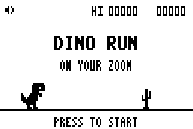
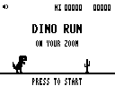

# Games

[Русский](README.ru.md) · [All projects](https://github.com/Leemuzhko/Zoom-ZDL-FX)

Games for Zoom pedals, installed as ZDL effects. Check each game's compatibility
before choosing a device.

## LM_DINO — DINO RUN 1.00

A dinosaur runner inspired by the Chrome dinosaur game, on your Zoom pedal.
Use the footswitch to jump over cacti, survive the increasing speed and beat
your preset's high score.

### Compatibility

| Pedal | Status |
| --- | --- |
| **Original MS-70CDR** | **Tested and working.** |
| **MS-50G / MS-60B** | May work; compatibility has not been tested. |
| **G1on / B1on family** | **Does not work.** The author reports no harm to the pedal. |

Compatibility information reflects the author's hardware report.

### Playing and saving

- **Short footswitch press:** start, jump or restart after a collision.
- **Sound in EDIT:** switch game sounds Off/On; this setting is saved with the preset.
- **Leave the game screen:** pause; return to resume the round.
- **High score:** stored per preset and effect slot. An improved record is updated
  at the end of a round and saved through the pedal's normal Auto Save or manual Save.

Holding the footswitch retains the pedal's normal tuner/tap-tempo function.
Gameplay presses do not change the preset's saved effect On/Off state.

### Installation

Extract **LM_DINO.zip** into your Zoom Effect Manager custom-effects folder and
keep all files together. Install **DINO RUN** from **PedalOperated (11 / 0x0B)**.
The effect ID is **0x33FF** (13311), version **1.00**.

[Full instructions, package identity and saving behavior](LM_DINO/README.md)
are also included in the individual download.

The preview uses the screen's **3:4 physical pixel ratio**. The ZEM image and
catalogue card show the same title screen in the standard Manager format.

Inspired by the Chrome dinosaur game. This independent project is not affiliated
with Google or Zoom Corporation.

<!-- BEGIN GENERATED EFFECT CATALOG -->

**Download all effects in this project: [All_GAMES.ZIP](https://github.com/Leemuzhko/Zoom-ZDL-FX/releases/latest/download/All_GAMES.ZIP)**

| Effect Card | Effect Description | Effect Group | ID | Version | Download |
| --- | --- | --- | --- | --- | --- |
|  | DINO RUN — a footswitch-controlled dinosaur runner with saved Sound and a per-preset high score. Tested on MS-70CDR. MS-50G/MS-60B may work, but remain untested. Does not work on the G1on/B1on family; the author reports no harm to the pedal. | PedalOperated (11) | 13311 | 1.00 | [LM_DINO.ZIP](https://github.com/Leemuzhko/Zoom-ZDL-FX/releases/latest/download/LM_DINO.zip) |

<!-- END GENERATED EFFECT CATALOG -->
